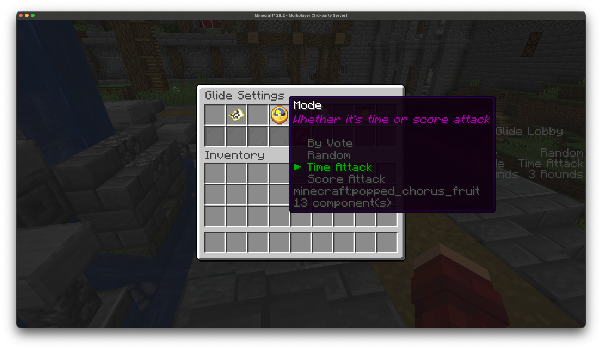
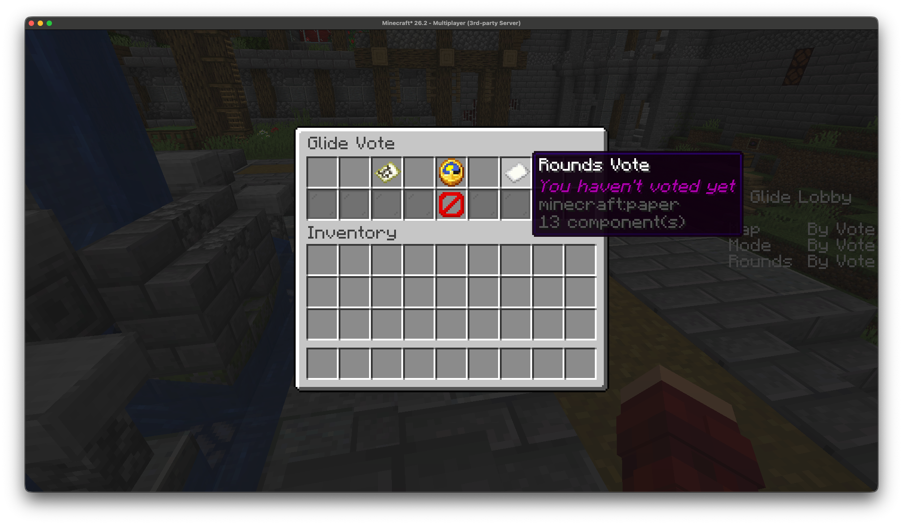

<br/>
<div align="center">
<a href="https://github.com/senseiwells/Glide">

</a>
</div>

## About The Project

This project aims to re-implement Minecraft Legacy Console Edition's
[glide minigame](https://minecraft.wiki/w/Glide_(mini_game)) completely server-side.

This is part of the [Legacy Edition Minigames Project](https://www.legacyminigames.net/).

### Built With

The majority of this mod relies upon the [arcade api](https://github.com/CasualChampionships/arcade)
which is a library designed for server-side fabric minigame development and is written in Kotlin.

## Getting Started

### Compiling

These are the steps for compiling Glide locally:

1. Clone the repo:
   ```sh
   git clone https://github.com/senseiwells/Glide.git
   ```
2. Build with Gradle:
   ```sh
   gradlew build
   ```
3. The mod will be built and located in your `build/libs` directory. You should install the
version named `Glide-<version>+<minecraft-version>.jar` as this bundles everything you need.

## Usage

### Installation

First, you will need a fabric server, follow
[this guide](https://wiki.fabricmc.net/player:tutorials:install_server)
if you do not have one already.

Glide also relies on the following mods, which you must have installed separately:
- [Fabric API](https://modrinth.com/mod/fabric-api)
- [Fabric Language Kotlin](https://modrinth.com/mod/fabric-language-kotlin)

<!-- ### Configuration -->
<!-- TODO: Add this section once custom maps are supported  -->

### In-game

When you join the server you'll immediately be dropped into the minigame lobby.

#### Settings

From the lobby admins can configure the glide settings by running `/glide settings`
which opens the following gui:


From here they can configure the map, the mode, and the number of rounds for the
glide minigame. They can also set these to "By Vote" to let players in the lobby
vote for an option, or "Random" for a random option. 

Additionally, admins can also configure the start delay which defaults to 60 seconds.
After this time the minigame will automatically start with all players in the lobby,
the delay can be skipped if all players ready up with `/glide ready`. The delay can
also be set to "Indefinite" which requires all players to ready up before starting.

#### Voting

If any option is set to "By Vote" then players can open the voting gui with
`/glide vote`.



#### Concurrent Games

Admins can set up concurrent glide games by creating multiple lobbies.
Additional lobbies can be created with `/glide create lobby <players>`, which
creates a new lobby with the players specified - their lobby/glide minigame will
then play independently of the original lobby.